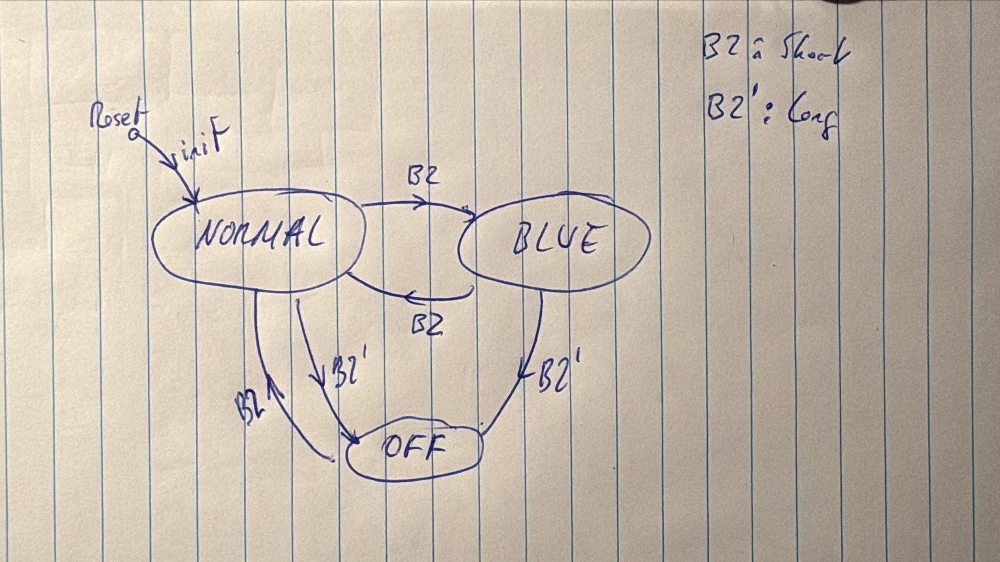

# Brightness Control - Group E

Hands-on lab for Embedded Platforms and Communications for IoT.

A brightness monitoring and control system for the NUCLEO-WL55JC.
An LDR is sampled by the ADC every 2 seconds and an RGB LED shows the brightness level. The B2
button switches between three operating modes:

| Mode | LED | ADC acquisition |
|---|---|---|
| `NORMAL` | RED < 33 % ≤ YELLOW ≤ 66 % < GREEN | every 2 s |
| `BLUE` | blue | suspended |
| `OFF` | off, prints `System OFF` | suspended |

## Members
- Omar Piñeiro
- Carlos Egea

## Gitflow conventions
- Follow standard gitflow for features
- `develop` is the default branch.
- To make changes a Pull Request to `develop` must be opened.

## Features to develop
- `feat/fsm`: Finite State Machine that manages the business logic.
- `feat/button`: Generate events from short and long presses.
- `feat/ldr`: Capture the LDR input and convert into luminosity (flexibility around the units).
- `feat/rgbLeds`: Control the RGB LED.
- `feat/serial`: Serial comms.

## Build and flash

The board overlay `boards/nucleo_wl55jc.overlay` is applied automatically, because Zephyr loads
`boards/<BOARD>.overlay` when it exists
([howtos.rst](https://github.com/zephyrproject-rtos/zephyr/blob/v4.4.2/doc/build/dts/howtos.rst?plain=1#L242)).
It describes a **common-cathode** RGB LED.

```sh
# Common-cathode RGB LED (default)
west build -p auto -b nucleo_wl55jc . -d build -- \
    -DBOARD_FLASH_RUNNER=openocd -DBOARD_DEBUG_RUNNER=openocd

# Common-anode RGB LED: add the extra overlay
west build -p auto -b nucleo_wl55jc . -d build -- \
    -DBOARD_FLASH_RUNNER=openocd -DBOARD_DEBUG_RUNNER=openocd \
    -DEXTRA_DTC_OVERLAY_FILE=boards/common_anode.overlay

# Flash
west flash -d build --cmd-pre-init "reset_config srst_only srst_nogate connect_assert_srst"
```

- `-DBOARD_FLASH_RUNNER=openocd`: the board's `board.cmake` selects `stm32cubeprogrammer` as the
  default flash runner. We use OpenOCD instead.
- `connect_assert_srst`: OpenOCD connects while holding the MCU in reset. With `CONFIG_PM=y` the
  firmware enters Stop mode as soon as every thread is blocked, and in Stop the debug port stops
  answering (Zephyr leaves `DBG_STOP` disabled unless `CONFIG_STM32_ENABLE_DEBUG_SLEEP_STOP=y`).
  Connecting under reset reaches the core before it can sleep. STMCubeProgrammer has a similar flag.
- In the repo there are no `.vscode/tasks` because we used very different setups to compile and flash even though we were using both Debian.

## Hardware components
### LDR

Powered through a GPIO pin so it is only energized while a measurement is being taken. This minimizes power consumption and reduces unnecessary current draw when the sensor is idle. Additionally, the ADC is managed by the Device Runtime Power Management to power off the ADC when not in use in order to save energy.

| LDR pinout | Board pinout |
|---|---|
| `-` | GND |
| `+` | D2 |
| `S` | A0 |

The ADC uses 12-bit resolution, so the raw value goes from 0 to 4095. The percentage is computed
against the full-scale range, `raw * 100 / 4095`, and then inverted (`100 - %`) so that a higher
value means more light.

### RGB

Powered through GPIO pins. 

| LED | Board pinout |
|---|---|
| Red | D4 |
| Green | D7 |
| Blue | D8 |

#### How to have agnostic hardware logic
Omar has a common-cathode RGB LED and Carlos a common-anode RGB LED. How can we configure this abstraction?

The answer is the devicetree. The application code only sets a LED *active* or *inactive*
(`gpio_pin_set_dt()` works with logical levels). Which voltage "active" means is described by the
GPIO flags in the overlay:

- `boards/nucleo_wl55jc.overlay`: `GPIO_ACTIVE_HIGH` (common cathode).
- `boards/common_anode.overlay`: overrides the three LED pins with `GPIO_ACTIVE_LOW`.

The second overlay is added with [EXTRA_DTC_OVERLAY_FILE](https://github.com/zephyrproject-rtos/zephyr/blob/v4.4.2/doc/build/dts/howtos.rst?plain=1#L220-L320), so each member only changes the build command (see [Build and flash](#build-and-flash)). The same source code drives both LEDs.

### Button

Button B2 is integrated in the board and in the devicetree it is the `sw1` alias, configured as `GPIO_ACTIVE_LOW | GPIO_PULL_UP`, so a logical `1` means *pressed*.

## Architecture

### Threads

| Thread | File | Priority | Role |
|---|---|---|---|
| `main` | `main.c`, `control.c` | 6 | Prints the banner, then runs the control logic (`control_run()`): the FSM waits for button events and LDR samples, decides the LED colour, drives the LED and decides whether the ADC runs. |
| `producer` | `sensors.c` | 7 | Initializes the LDR and the button. Reads the LDR every 2 s while the ADC is enabled. |

After the project review, control moved into the main thread and the actuator thread was removed:

- `main` only slept after printing the banner, so its stack was wasted. It now runs the control
  logic, at `CONFIG_MAIN_THREAD_PRIORITY=6` (`prj.conf`) to stay above the producer, as the old
  control thread did.
- Setting the LED is three GPIO writes: it never blocks and takes microseconds, so it does not
  need its own thread. `control.c` calls `rgb_set()` directly, and only when the colour changes.

#### RAM saved

Measured by comparing the RAM symbols (`arm-zephyr-eabi-nm -S`) of `zephyr.elf` before and after
the change. Only these symbols differ:

| Symbol | Bytes |
|---|---|
| `control` thread stack | −1088 |
| `actuator` thread stack | −1088 |
| `control` thread object (`struct k_thread`) | −136 |
| `actuator` thread object (`struct k_thread`) | −136 |
| `q_rgb_data` queue object | −48 |
| `q_rgb_data` buffer (10 messages × 3 B) | −30 |
| **Total** | **−2526** |

This matches `arm-zephyr-eabi-size`: `data + bss` went from 12984 B to 10458 B (RAM use from about 20%
to 16% of 64 KB). Code (`text`) also dropped by 100 B, from 42032 B to 41932 B.

Most of the saving comes from the stacks: each thread reserves its whole stack statically, used or
not. `main` already had its own (`CONFIG_MAIN_STACK_SIZE=1024`), which is now used instead of
sleeping. Each removed stack takes 1088 B instead of the requested 1024 B; the extra 64 B are most
likely the MPU stack guard (`CONFIG_MPU_STACK_GUARD=y`).

### Button events

The button logic relies on its interrupt (both edges) and two delayable works:

- `debounce_work`: every edge *reschedules* it 60 ms later, so it only runs once the signal has been
  stable for 60 ms. It then reads the button level and, on release, sends a `BUTTON_SHORT_PRESS`
  unless a `BUTTON_LONG_PRESS` was already sent or the press qualifies as a `BUTTON_LONG_PRESS` 
  and `long_work` did not send the event yet.
- `long_work`: scheduled when the button is pressed. If the button is still held after 1000 ms, it
  sends a `BUTTON_LONG_PRESS` immediately, without waiting for the release. A `long_sent` flag stops
  the release from also producing a short press.


## FSM

Three states, driven by two events from the button:

| State \ Event | `BUTTON_SHORT_PRESS` | `BUTTON_LONG_PRESS` |
|---|---|---|
| `NORMAL` | `BLUE` | `OFF` |
| `BLUE` | `NORMAL` | `OFF` |
| `OFF` | `NORMAL` | `OFF` |

`B2` = short press, `B2'` = long press (≥ 1 s).



`fsm()` is a Mealy machine, called on every button event and every LDR sample. It has three parts:

1. **Evaluate the button event** (previously explained).
2. **Commit the state:** store the new state, log it if it changed, and clear the button event to
  not handle it again on the next LDR sample.
3. **Update the outputs:** in `NORMAL`, enable ADC sampling and select RED below 33%, YELLOW from
  33% through 66%, or GREEN above 66%. In `BLUE`, show blue and disable ADC sampling. In `OFF`,
  turn the LED off and disable ADC sampling. Write the LED only when the colour needs to be
  changed.

## Interfaces
To avoid problems between the threads, data is passed through [message queues](https://github.com/zephyrproject-rtos/zephyr/blob/v4.4.2/doc/kernel/services/data_passing/message_queues.rst?plain=1).

The interface is defined in `src/interface.h`:

| Item | Type | Content |
|---|---|---|
| `q_ldr_data` | `ldr_t` | `brightness` in % (0–100) |
| `q_button_data` | `button_type_of_event_t` | `BUTTON_SHORT_PRESS` / `BUTTON_LONG_PRESS` |
| `e_enable_devices` | `struct k_event` | bit `EV_ADC_ON` |

The queues are defined in `main.c` with `K_MSGQ_DEFINE`, and the event object in `control.c` with
`K_EVENT_DEFINE`.

## Serial output

All output goes through Zephyr's logging subsystem (`CONFIG_LOG=y`, deferred mode). Each source file
registers its own module (`control`, `sensors`, `ldr`, `button`, `gpio`, `main`), so
every line shows a timestamp, the level and the module. Levels follow their meaning:

## Testing

Tested by hand on the NUCLEO-WL55JC board:

| Test | Expected |
|---|---|
| Boot | `fsm: NORMAL`, LED on after the first sample |
| Cover / uncover the LDR in `NORMAL` | RED / YELLOW / GREEN by brightness |
| Short press in `NORMAL` | `BLUE`, LED blue, no more LDR readings |
| Short press in `BLUE` | `NORMAL`, a reading appears immediately |
| Long press (hold) | `OFF` and `System OFF` at 1 s, while still held |
| Release after a long press | no short press |
| Short press in `OFF` | `NORMAL` |
| Two quick short presses | back to the starting mode |

## References

All Zephyr links point to the version this project is built with, **v4.4.2**.

### Zephyr kernel
- [Threads](https://github.com/zephyrproject-rtos/zephyr/blob/v4.4.2/doc/kernel/services/threads/index.rst?plain=1): `K_THREAD_DEFINE`, priorities, start delay.
- [Scheduling](https://github.com/zephyrproject-rtos/zephyr/blob/v4.4.2/doc/kernel/services/scheduling/index.rst?plain=1): preemptive vs. cooperative priorities.
- [Workqueue threads](https://github.com/zephyrproject-rtos/zephyr/blob/v4.4.2/doc/kernel/services/threads/workqueue.rst?plain=1): `k_work_delayable`, `k_work_reschedule` (button debounce and long press).
- [Message queues](https://github.com/zephyrproject-rtos/zephyr/blob/v4.4.2/doc/kernel/services/data_passing/message_queues.rst?plain=1): `K_MSGQ_DEFINE`, `k_msgq_put` / `k_msgq_get`.
- [Polling API](https://github.com/zephyrproject-rtos/zephyr/blob/v4.4.2/doc/kernel/services/polling.rst?plain=1): `k_poll`, `K_POLL_MODE_NOTIFY_ONLY`, resetting `state` after each call.
- [Events](https://github.com/zephyrproject-rtos/zephyr/blob/v4.4.2/doc/kernel/services/synchronization/events.rst?plain=1): `K_EVENT_DEFINE`, `k_event_post` / `k_event_clear` / `k_event_wait`.
- [Kernel API header](https://github.com/zephyrproject-rtos/zephyr/blob/v4.4.2/include/zephyr/kernel.h): function-level documentation of all the above.
- [Common multithreading problems and their fixes](https://www.zephyrproject.org/common-multithreading-problems-and-their-fixes/) (Zephyr Project blog).

### Zephyr drivers, devicetree and power management
- [GPIO](https://github.com/zephyrproject-rtos/zephyr/blob/v4.4.2/doc/hardware/peripherals/gpio.rst?plain=1): `gpio_dt_spec`, logical levels, pin interrupts and callbacks.
- [ADC](https://github.com/zephyrproject-rtos/zephyr/blob/v4.4.2/doc/hardware/peripherals/adc.rst?plain=1): `adc_dt_spec`, `adc_sequence`, `adc_read_dt`.
- [Devicetree how-tos](https://github.com/zephyrproject-rtos/zephyr/blob/v4.4.2/doc/build/dts/howtos.rst?plain=1#L220-L320): board overlays and `EXTRA_DTC_OVERLAY_FILE`.
- [Device runtime power management](https://github.com/zephyrproject-rtos/zephyr/blob/v4.4.2/doc/services/pm/device_runtime.rst?plain=1): `pm_device_runtime_get` / `put` for the ADC.
- [System power management](https://github.com/zephyrproject-rtos/zephyr/blob/v4.4.2/doc/services/pm/system.rst?plain=1): Stop modes entered from the idle thread (`CONFIG_PM`).
- [Logging](https://github.com/zephyrproject-rtos/zephyr/blob/v4.4.2/doc/services/logging/index.rst?plain=1): modules, levels, deferred mode, rate-limited macros.

### Zephyr board, tools and samples
- [NUCLEO-WL55JC board page](https://github.com/zephyrproject-rtos/zephyr/blob/v4.4.2/boards/st/nucleo_wl55jc/doc/nucleo_wl55jc.rst?plain=1): pinout, supported features, flashing.
- [Building, flashing and debugging with west](https://github.com/zephyrproject-rtos/zephyr/blob/v4.4.2/doc/develop/west/build-flash-debug.rst?plain=1): `west build`, `west flash`, runners.
- [Button sample](https://github.com/zephyrproject-rtos/zephyr/blob/v4.4.2/samples/basic/button/README.rst?plain=1): GPIO interrupt with a callback.
- [ADC devicetree sample](https://github.com/zephyrproject-rtos/zephyr/blob/v4.4.2/samples/drivers/adc/adc_dt/README.rst?plain=1): ADC channel defined in the devicetree.
- [Threads sample](https://docs.zephyrproject.org/latest/samples/basic/threads/README.html): statically defined threads.

### STMicroelectronics documentation
- UM2592 Rev 3, *STM32WL Nucleo-64 board (MB1389)* user manual: board layout, push-buttons (§6.6.2), pin assignment.
- DS13293 Rev 5, *STM32WL55xx/54xx* datasheet.
- RM0453 Rev 6, *STM32WL5x* reference manual: ADC, GPIO, power modes, `DBGMCU`.
- ES0500 Rev 6, *STM32WL55xx/54xx* device errata.
- PM0214 Rev 10, *STM32 Cortex-M4 MCUs and MPUs* programming manual.

### Course and conventions
- *EPC for IoT – Zephyr OS, 4th week: Hands-on lab, exercise specification* (`05_EmbeddedSystems_Hands-on_Exercise_2026_27.pdf`, Moodle).
- [Conventional Commits 1.0.0](https://www.conventionalcommits.org/en/v1.0.0/).
