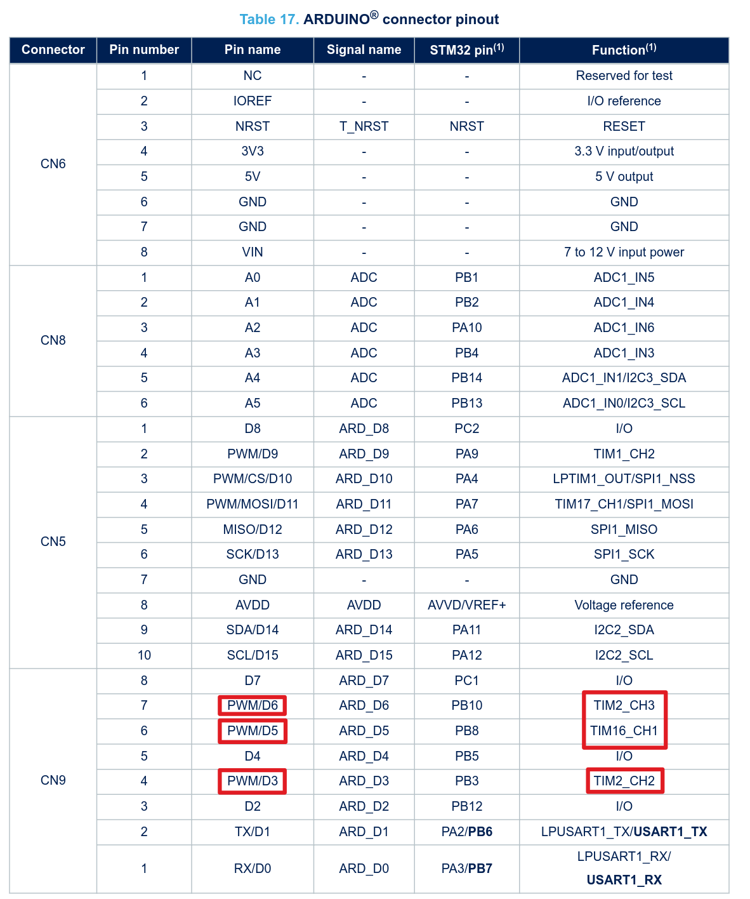
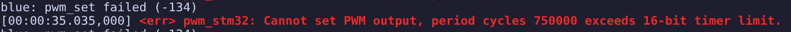

# PWM

References can be found at [README.md](../README.md).

To configure the overlay. Default configs are at: `zephyr/dts/arm/st/wl/stm32wl.dtsi`

Here is an example of the default configuration for the timmer 2.

```c
timers2: timers@40000000 {
    compatible = "st,stm32-timers";
    reg = <0x40000000 0x400>;
    clocks = <&rcc STM32_CLOCK(APB1, 0)>,
            <&rcc STM32_SRC_TIMPCLK1 NO_SEL>;
    resets = <&rctl STM32_RESET(APB1L, 0)>;
    interrupts = <27 0>;
    interrupt-names = "global";
    st,prescaler = <0>;
    status = "disabled";

    pwm {
        compatible = "st,stm32-pwm";
        status = "disabled";
        #pwm-cells = <3>;
    };

    counter {
        compatible = "st,stm32-counter";
        status = "disabled";
    };
};
```
Observe that `pwm { ... status ="disabled"; ...}` is the default. So we need to change that in the overlay. And since for connecting (prelilminary pinout) the RGB color we need different pins connected to different timmers, timmer 2 and timmer 16:


The [overlay](../boards/nucleo_wl55jc.overlay) overrides the zephyr defined board `zephyr/boards/st/nucleo_wl55jc/nucleo_wl55jc.dts` which in turn overrides the **SoC DTS** `zephyr/dts/arm/st/wl/stm32wl.dtsi`.
That is way pwm2 is defined in the board but pwm16 is not and we need to define it.

The way to deffine several pins for a timmer is to use a list inside `< >`, like so:
```c
pinctrl-0 = <&tim2_ch2_pb3 &tim2_ch3_pb10>;
``` 
 The aliases later need to assign each channel to each timer, so we must use the timer channel, not the pin number.

> My board (Carlos) is common-anode, so we need  PWM_POLARITY_INVERTED for that hardware.

## Error on different periods for each timer

The sys clock works at 48 MHz with no prescaler, so TIM16 also works at 48 MHz. THe TIM 16 has a 16 bit counter that increases each 20.8 ns at that speed, so the conter ends at 65 636 ticks, that is very fast. So The max period is 65536 / MHz is 1.365 ms. It does not affect TIM2 as it has a 32 bit counter.

### The fix - Short period
With 1 ms as 48k ticks with no prescaler is lower than the max counter value. and it should be done for each timer for compatibility.

